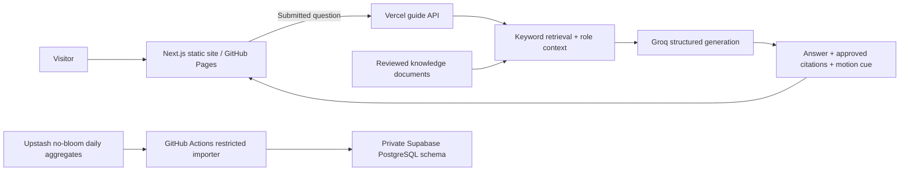

# Ali Nguyen · Applied AI and Product Engineer

The public portfolio of **Nguyen Quang Duy (Ali Nguyen)**, founder of DUYTRUYENTHONG. It presents applied AI prototypes, evaluated customer-data work, developer tooling, and live digital commerce products with their evidence and limits visible.

[Live portfolio](https://duytruyenthong.github.io/Alinguyen-portfolio/) · [Selected work](https://duytruyenthong.github.io/Alinguyen-portfolio/work/) · [About Ali](https://duytruyenthong.github.io/Alinguyen-portfolio/about/) · [GitHub profile](https://github.com/DUYTRUYENTHONG)

> **Public for review; not a template.** The original design, code, writing, and owner-created assets are all rights reserved. Public access does not grant permission to reuse or redeploy them. See [LICENSE](LICENSE) and [Credits](https://duytruyenthong.github.io/Alinguyen-portfolio/credits/) for third-party material and brand marks. A public repository and public website can still be viewed, forked, cloned, or inspected; this notice states reuse terms rather than claiming a technical copy barrier.

## Review paths

| If you are reviewing | Start here |
| --- | --- |
| An applied AI or engineering role | [Recruiter brief](docs/RECRUITER_BRIEF.md), [Applied AI CV](https://duytruyenthong.github.io/Alinguyen-portfolio/cv-applied-ai-engineer.pdf), and [project cases](https://duytruyenthong.github.io/Alinguyen-portfolio/work/). |
| A master's application | [Academic brief](docs/ACADEMIC_BRIEF.md), the [KKBox evaluation](https://github.com/DUYTRUYENTHONG/kkbox-customer-churn-prediction/blob/main/docs/RESULTS.md), and the [Applied AI CV](https://duytruyenthong.github.io/Alinguyen-portfolio/cv-applied-ai-engineer.pdf). |
| Implementation and design | [Portfolio creation guide](docs/PORTFOLIO_CREATION_GUIDE.md), [source](src/app/), and [content data](src/data/portfolio.ts). |

## Selected evidence

| Work | Current status and what can be inspected |
| --- | --- |
| [Growth Commerce OS](https://growth-commerce-os.vercel.app/en) | Live service website. Its public pages show the offer and workflows; business outcomes are not measured here. |
| [STOS](https://stosvn.vercel.app/stos) | Live sales-page product. AI suggestions are planned, not a live capability. |
| [Chợ Kênh](https://growth-commerce-os.vercel.app/cho-kenh) | Live catalog and manual inquiry flow; no automated checkout or escrow. |
| [Vibecode Product Kit](https://github.com/DUYTRUYENTHONG/vibecode-product-kit) | Public developer-tool source, offline CLI, and CI checks. |
| [KKBox churn baseline](https://github.com/DUYTRUYENTHONG/kkbox-customer-churn-prediction) | Public source and official-data local holdout. The [results](https://github.com/DUYTRUYENTHONG/kkbox-customer-churn-prediction/blob/main/docs/RESULTS.md) report 0.217324 log loss and 0.819295 ROC AUC on a within-cohort split, with a synthetic future-event leakage check. This is not a leaderboard, out-of-time, production, or business-impact result. |

The knowledge-assistant work is a prototype, not a deployed support service. The portfolio guide is a separate, on-demand assistant for navigating public portfolio evidence; it can return a labelled approved-source excerpt if generation fails, or static links if the API is unavailable. Neither feature is evidence of customer adoption.

## How this portfolio is made

This repository contains three deployable parts: a static portfolio, a separate AI/traffic API, and a private analytics importer. See the [AI engineering implementation guide](docs/AI_ENGINEERING_IMPLEMENTATION.md) for the source map, request lifecycle, evaluation procedure and operational boundaries.



**The warehouse is not currently connected to guide retrieval.** Consent-based portfolio interaction signals now live in a separate Redis collection and provide a bounded relevance tie-break. See [recommendation implementation](docs/PORTFOLIO_RECOMMENDATIONS.md). The `no-bloom` source is a separate project, not portfolio engagement data.

- **Frontend:** Next.js 16 App Router, React 19, TypeScript, a static export, self-hosted Inter and Archivo fonts, and scoped CSS for the editorial sections. The hero changes its emphasis for a selected visitor perspective or entry link; the base layout stays consistent.
- **Content:** `src/data/portfolio.ts` is the main record for identity, projects, expertise, collaborations, and capabilities. Case pages, briefs, and CVs preserve the distinction between live work, public code, prototypes, plans, and measured local results.
- **Interactions:** The named guide characters use local motion. Questions are sent only after a visitor submits them to the separate [Vercel guide API](visitor-api/README.md). API keys stay server-side. The independent visitor counter uses that API project as well.
- **Presentation:** The customer display shows 15 owner-confirmed names once, including 14 existing logo assets and one name-only entry. The adjacent About section uses conceptual illustrations; neither logos nor diagrams imply endorsements or measured outcomes.
- **Deployment:** A push to `main` starts GitHub Actions. It exports the site under `/Alinguyen-portfolio` and deploys to GitHub Pages only after the checks pass.

The [portfolio creation guide](docs/PORTFOLIO_CREATION_GUIDE.md) explains the content workflow, architecture, local setup, quality checks, and release process. [Asset provenance](docs/ASSET_PROVENANCE.md) and the [Credits page](https://duytruyenthong.github.io/Alinguyen-portfolio/credits/) identify visual references and third-party assets.

## Local development for authorized collaborators

Use Node.js 22 and the committed lockfile:

```sh
npm ci
npm run dev
```

Open `http://localhost:3000`. The static pages work without API credentials. To test the optional visitor counter and guide locally, see [visitor-api/README.md](visitor-api/README.md); keep `GROQ_API_KEY`, Upstash tokens, and salts on the server, never in `NEXT_PUBLIC_` variables or this repository.

Before a release, run:

```sh
npm run typecheck
npm run lint
npm --prefix visitor-api ci
npm --prefix visitor-api test
npm --prefix analytics ci
npm --prefix analytics test
npm run test:guide
npm --prefix visitor-api run smoke:production
npm run build
```

The Pages workflow supplies `NEXT_PUBLIC_BASE_PATH=/Alinguyen-portfolio`, `NEXT_PUBLIC_SITE_URL`, and the public API URLs during its build. Run `npm run build` with the same public variables to check the deployed path locally. The exported files are in `out/`.

The guide uses a native modal dialog with visual-viewport sizing, safe-area spacing, and a scrollable conversation. For changes to it or shared layout, repeat the phone, short-viewport, keyboard, navigation and route checks recorded in the [responsive QA report](docs/qa/responsive-2026-10-22/QA_REPORT.md), including a real Safari keyboard check when an iPhone is available.

## Downloads and source notes

The site offers four CV actions: [Applied AI Engineer PDF](https://duytruyenthong.github.io/Alinguyen-portfolio/cv-applied-ai-engineer.pdf), [Business & Product PDF](https://duytruyenthong.github.io/Alinguyen-portfolio/cv-business-product.pdf), [Business Development PDF](https://duytruyenthong.github.io/Alinguyen-portfolio/cv-business-development.pdf), and [AI / Prompt Engineer DOCX](https://duytruyenthong.github.io/Alinguyen-portfolio/cv-prompt-engineer.docx). The business PDFs now have distinct role narratives. The AI documents state the qualified KKBox local holdout result and its limits. The owner should review personal details before each public update; the source generator is `scripts/generate-ai-cvs.py`.

Client and collaboration names were confirmed by Ali Nguyen. Individual testimonials and performance claims are not included. Original brand marks remain the property of their respective owners. The [Recruiter brief](docs/RECRUITER_BRIEF.md) and [Academic brief](docs/ACADEMIC_BRIEF.md) give fuller context without presenting prototypes as production systems or the KKBox local split as future-cohort performance.

## Engineering evidence added October 2026

- [Traffic-to-PostgreSQL pipeline](analytics/README.md): verified locally with PGlite and on hosted Supabase PostgreSQL. The restricted loader imports `no-bloom` production daily aggregates with TLS verification, transactional snapshots, reconciliation and replay protection. The [first manually dispatched production job passed](https://github.com/DUYTRUYENTHONG/Alinguyen-portfolio/actions/runs/40283819868); daily scheduling is enabled at 00:17 UTC / 07:17 Bangkok. The first time-triggered execution has not yet been observed in this report. Upstash remains the operational store.
- [AI guide evaluation](docs/evidence/AI_GUIDE_EVALUATION.md): 16 live baseline requests, 12 HTTP 200 responses, four service errors, nine original heuristic passes. Full failures and rubric limitations are retained; this is not an accuracy benchmark.
- [Evidence page](https://duytruyenthong.github.io/Alinguyen-portfolio/evidence/): a clearly labelled synthetic analytics demonstration and the guide baseline. Actual traffic records remain private.

Run `npm --prefix analytics ci` and `npm --prefix analytics test` for SQL checks. Use `npm --prefix analytics run demo` to regenerate the synthetic record. Regenerate only the AI CVs with `python scripts/generate-ai-cvs.py --ai-only`; render and inspect both outputs before committing them. Business CVs remain unchanged by that option.

## Documentation map

| Guide | Purpose |
| --- | --- |
| [AI engineering implementation](docs/AI_ENGINEERING_IMPLEMENTATION.md) | Retrieval, generation, citations, evaluation, source updates and limitations |
| [Portfolio creation](docs/PORTFOLIO_CREATION_GUIDE.md) | Frontend architecture, design and content maintenance |
| [API setup](visitor-api/README.md) | Separate Vercel service, environment configuration and traffic API |
| [Analytics pipeline](analytics/README.md) | Snapshot semantics, SQL, replay and local reproduction |
| [Supabase setup](docs/SUPABASE_SETUP.md) | Hosted schema and access restrictions |
| [Automated imports](docs/AUTOMATED_TRAFFIC_IMPORTS.md) | Private credentials, daily runner, recovery and activation gates |
| [Hosted QA evidence](docs/evidence/SUPABASE_WAREHOUSE_QA.md) | Dated checks and remaining operational work |

### Current limits

- Retrieval uses reviewed documents and weighted keywords; no embedding model, vector index, fine-tuning or warehouse-driven recommendations are deployed. Optional Redis interaction aggregates can break close relevance ties.
- The live guide evaluation is a historical baseline, not a measurement of the latest release. A successful smoke check does not establish factual accuracy.
- Public analytics examples are synthetic. Private visitor data and database credentials must never enter Git, browser bundles or model prompts.
- External stale-import alerts, backup restoration tests and load testing remain outstanding.
- The public evidence page and guide now describe hosted checks and the recommendation feature. Downloaded CVs still describe the earlier milestone; they are not silently regenerated by this release.

## Shared with the community

The homepage includes a separate community resource after the applied AI examples: [Vietnam Career Agent Kit](https://github.com/DUYTRUYENTHONG/vietnam-career-agent-kit). It is a free MIT-licensed Python/SQLite kit for local job-search preparation and supervised application workflows. Agent services may cost separately; no employment outcome is promised. The five featured commerce/developer/data builds remain unchanged. Content lives in `communityResource` in `src/data/portfolio.ts`; presentation is scoped to `community-resource-section`.

## NPC-style portfolio companion

Choosing a perspective opens a persistent introduction with a three-stop, role-aware tour. Visitors control navigation and explicitly choose when to open AI chat. Existing character artwork uses lightweight layered motion; it is not a rigged 3D model. Reduced-motion preferences disable the new animation.

See [the executed implementation prompt and acceptance criteria](docs/NPC_GUIDE_IMPLEMENTATION_PROMPT.md).

### Work directory community listing

`/work/` includes Vietnam Career Agent Kit alongside the five featured builds (six total; two in AI & data). It reuses `communityResource` from `src/data/portfolio.ts` and links directly to the public repository. The homepage still has five featured case studies plus its separate community section. Browser QA checked All/AI & data counts, the GitHub destination, 44px filter targets, and overflow at 320, 390, 768 and 1280px.
