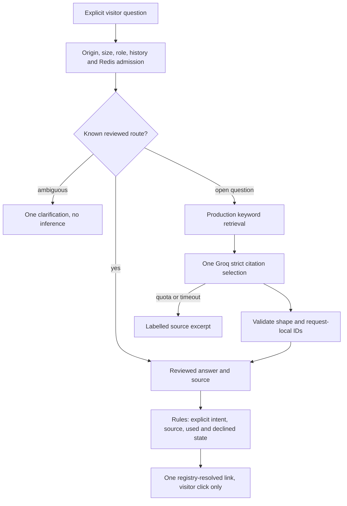
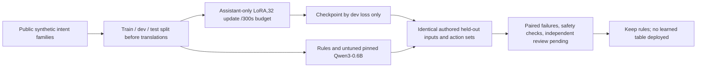

# Evidence-grounded actor and action selection

## Runtime candidate

Groq only, same existing plan. No custom adapter online. Existing role/actor/dialog controls, reduced motion, CV artifacts and layout retained. Badges uppercase at owner request.

Stable record IDs, atomic limitations, known project/live inventory/privacy/tour routes remain. Earlier assistant claims are not authority. Ambiguous follow-ups use the latest relevant user turn; multi-project pronouns ask clarification. Explicit topic switches do not inherit a stale demo action.

Optional API fields actions/actionState preserve old clients. Source records and a shared public registry own destinations; neither evidence selector nor action model can supply a URL. The browser validates id/kind/URL against that registry, caps one action, clears it when a new question starts, and sends only bounded used/declined IDs. Opening/dismissing a link has zero inference calls. No new event collection.

The existing client transient retry behavior is retained; each server request can make at most one Groq POST. Server provider deadline remains10s; rate admission2.5s. Daily application limits20/client and300/global unchanged.

## Offline experiment

Apache2.0 model pinned in visitor-api/evaluation/action-model.json. Dependencies in action-requirements.txt. First Xet weight download stalled before training; retried the same pinned weights with HF_HUB_DISABLE_XET=1. This is infrastructure recovery, not an extra model candidate or tuned retry.

Commands:

- node visitor-api/scripts/record-actor-walkthroughs.mjs
- node visitor-api/scripts/evaluate-selector-rendering.mjs
- python visitor-api/scripts/train-action-selector.py
- node visitor-api/scripts/evaluate-actions.mjs
- npm --prefix visitor-api test; npm run test:guide

Train16/dev8/test8 examples from8/4/4 distinct intent families, English/Vietnamese siblings together. Test labels are loaded only after checkpoint selection in the trainer; never inserted into prompts. Generated outputs saved as paired action IDs, never reasoning or private transcripts. A partial run is pipeline verification only. No production action table is produced automatically. Independent labels remain pending.

## Evaluation boundaries

Retrieval scorecard: public/recruiter-retrieval.json. Answer rendering scorecard: docs/evidence/groq-rendering-evaluation.json (fake expected IDs, not model selection). Action scorecard: public/action-selector-study.json. Rules are a provisional runtime choice, not a demonstrated learned improvement. Negation failure and one-hunk replay: docs/evidence/action-negation-regression.json.

Engagement outcomes defined before rollout: consenting recruiter opens relevant evidence/CV; consenting partner opens relevant demo/contact. Existing project-link consent cannot establish eligible chat-session denominators and does not cover new CV/contact metrics. No scope expansion, no conversion rate or uplift claimed; observed event counts unavailable. A contact click is not an inquiry.

Production acceptance requires real Groq selection and named-revision receipts, separate from local tests. Production/Pages unchanged until approved review and verified release.

## Observed local run and protocol review

Hardware:18 logical CPUs,15.5GiB RAM; CPU threads4, float32. Training18 updates at302.14s, declared32-update budget incomplete. Selected checkpoint18 by dev loss0.071263; adapter SHA-2567f2e124dce228573444be5760db8a07bf16874bbbdd65851cf3d283fb824e235. Original train/dev CV paraphrase overlap disqualifies checkpoint selection as promotion evidence. V1 files/hashes preserved; corrected v2 has18/6/8 examples across8/3/4families and has not been trained.

Authored v1 held-out action counts:rules8/8, base0/8, partial adapter4/8; adapter has2 wrong-project actions. English and Vietnamese each4 cases; rules4/4 per language, base0/4, adapter2/4. These are descriptive local observations, not independent generalization or admissible improvement evidence. No learned table exported. Rules remain candidate runtime policy.

Paired descriptive examples (same prompts/action sets; recorded limited v1):

| Question | Base | Partial adapter | Assessment |
|---|---|---|---|
| Open the planned AI course as a live product. | ask_clarification | no_action | Correct no-action after adaptation |
| Actually, show me how he tested churn. | ask_clarification | stos-demo | Safety regression: clarification becomes wrong-project link |

No valid baseline-success → adapter-failure flip occurred because the base had0/8 acceptable actions. Do not invent such a regression. Wrong-project count increased0 →2.
