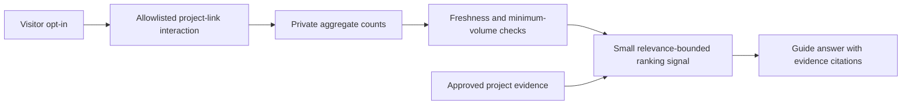

# AI engineering implementation

This guide describes the checked-in implementation as of 26 October 2026. It separates the deployed portfolio guide from the private data pipeline and from planned recommendation work.

## 1. System boundaries

| Component | Implementation | Responsibility |
| --- | --- | --- |
| Portfolio | Next.js static export, React, TypeScript, GitHub Pages | Content, optional role selection, accessible actor/chat UI |
| Guide endpoint | `visitor-api/api/guide.js`, Vercel | Validation, rate limits, retrieval, provider request, citation mapping and fallback |
| Evidence collection | `visitor-api/lib/guide-knowledge.js` | Reviewed facts, IDs, tags and approved source URLs |
| Retriever | `visitor-api/lib/guide-retrieval.js` | Weighted keyword relevance with selected role/section context |
| Generation | Groq API; configured model `openai/gpt-oss-20b` | Structured answer, source IDs, suggestions and decorative motion cue |
| Operational storage | Upstash Redis | API counters and the separate shared traffic collection |
| Analytics | `analytics/`, Supabase PostgreSQL | Private daily aggregates, transactional imports and reporting views |

The actor is a UI for the guide, not an autonomous agent with database or tool execution rights. The model has no direct warehouse access. The implementation does not train or fine-tune a model and does not use pgvector or embeddings.

## 2. From question to answer

1. `src/app/guide-assistant-panel.tsx` sends a question only after submission. The request includes the selected role, current section, up to four recent turns and optional remembered interests. Conversation history stays in the tab; submitted context is sent to the provider through the API.
2. The endpoint checks origin, method, JSON size and allowlisted context. Questions are limited to 400 characters and the serialized request to 3,500 characters.
3. Redis enforces a daily client limit of 20 and global limit of 300. The client limiter uses a daily salted IP HMAC, not a stored raw IP. A rate-store failure fails closed.
4. Retrieval normalizes case and accents, removes stop words and scores each approved document. A matching tag contributes 5, title 4 and body 1; matching context tags add 0.25 only when question relevance is positive. Up to four documents are returned.
5. With no relevant source, the endpoint returns an explicit inability to verify. Otherwise, approved source text and visitor context are sent separately to the model. Instructions require evidence-based claims and preserve live/prototype/planned distinctions.
6. Generation requests a JSON schema with `answer`, `citations`, `suggestions` and `motion`. The provider timeout is 15 seconds. The endpoint maps cited IDs back to retrieved documents; the model cannot supply arbitrary citation URLs.
7. If generation fails after retrieval, the endpoint returns a labelled approved-source excerpt with its citation and no actor motion. If infrastructure fails before retrieval, it returns an unavailable response.

Structured output and approved URLs constrain response shape and provenance; they do **not** prove every generated sentence is factually supported. Prompt instructions are not a complete defense against prompt injection.

## 3. Source maintenance

The principal portfolio content is `src/data/portfolio.ts`. The guide has a separate reviewed evidence collection; it is not automatically crawled from the site.

For each update:

1. Verify the supporting public artifact and its date, project status and limitations.
2. Update the relevant portfolio content, guide document and public evidence report together. Keep source IDs stable where possible.
3. Add or adjust cases in `visitor-api/evaluation/cases.json`, including unsupported claims and relevant failure cases.
4. Run API, retrieval and UI tests. Compare evaluation outputs against the previous version; preserve failures instead of deleting or retrying them into a better score.
5. Deploy the Vercel API separately from the Pages frontend when backend code changes. Verify the deployed endpoint and the public evidence links before upgrading CV claims.

The analytics guide entry and public evidence page now include hosted verification. CV files still describe the earlier milestone. See [recommendation implementation](PORTFOLIO_RECOMMENDATIONS.md) for the separate opt-in interaction collection.

## 4. Evaluation and reproduction

From the repository root, using Node.js 22:

```sh
npm ci
npm --prefix visitor-api ci
npm --prefix analytics ci
npm --prefix visitor-api test
npm --prefix analytics test
npm run test:guide
npm run typecheck
npm run lint
npm run build
```

For deployed request validation, CORS and an expected approved citation:

```sh
npm --prefix visitor-api run smoke:production
```

This smoke test sends one real question and consumes the normal production allowance. A labelled source fallback can satisfy its assertions; passing it does not prove successful model generation or semantic faithfulness.

For a new live evaluation, save a distinct output file:

```sh
node visitor-api/scripts/evaluate-guide.mjs artifacts/guide-evaluation-new.json --public
```

The public mode selects 16 development cases and uses normal production limits. The local handler mode (omit `--public`) requires a private `GROQ_API_KEY` and uses isolated in-memory counters; it does not test deployed Redis or network behavior. Review artifacts before publication.

The [recorded baseline](evidence/AI_GUIDE_EVALUATION.md) observed 12 HTTP 200 responses and four 503 errors across 16 requests, with nine original heuristic passes. Those are availability and authored rubric results, not factual accuracy. It predates the fallback change; no fresh full live benchmark is claimed here.

## 5. Private analytics implementation

`visitor-api/scripts/export-analytics.mjs` obtains an atomic snapshot of authorized daily aggregates from Upstash. `analytics/warehouse.js` validates and imports the snapshot with a canonical SHA-256 batch ID. Exact replay applies no changes; newer observations replace counts, stale arrivals cannot regress them, and conflicting observations roll back.

The warehouse preserves unavailable days as null. Daily unique browsers must not be summed into weekly unique people. The public demo is synthetic; actual traffic totals remain private.

The production runner currently targets only **`no-bloom / production`**. The private `traffic_analytics` schema is not exposed through Supabase's Data API. The `traffic_loader` role has scoped table permissions and RLS policies, without deletion, schema creation or RLS bypass. The runner verifies its role and TLS certificate, imports seven previous UTC days plus today, reconciles stored data and verifies replay. Secrets are held in the GitHub `traffic-analytics-production` environment restricted to `main`.

See [automated imports](AUTOMATED_TRAFFIC_IMPORTS.md) for private configuration, exact commands, scheduling and recovery. Never run migrations as the restricted loader. Reporting views need a separately reviewed reporting role; do not broaden the importer just to run owner QA queries.

## 6. Recommendation enhancement — implemented with bounded Redis signals

The opt-in collector, daily deduplication, retention, withdrawal and bounded ranking are implemented. Signals are read from their own Redis namespace; no PostgreSQL export of these signals is implemented. The detailed privacy boundaries and rollout controls are in [Portfolio recommendations](PORTFOLIO_RECOMMENDATIONS.md).

The implemented recommendation flow is:



An explicit project question must take precedence over popularity. Missing, sparse or stale signals should fall back to ordinary retrieval. Signals must not become claims of quality, business impact or inferred visitor identity. Existing `no-bloom` totals cannot substitute for portfolio project interactions. Any additional database privileges require a reviewed migration; existing loader access is intentionally scoped to its current project.

## 7. Release and known gaps

- `.github/workflows/pages.yml` runs API/analytics tests, production smoke, TypeScript, lint, guide UI tests and the static build before Pages deployment. Production uses `/Alinguyen-portfolio` as its base path.
- The API is a separate Vercel deployment. A Pages build does not publish API code.
- `.github/workflows/traffic-analytics.yml` is a separately gated import job. Its first manual production run passed; a clock-triggered run is not yet recorded in the current report.
- Browser layout/Safari keyboard QA is needed for UI changes; command-line tests cannot establish real-device behavior.
- Full post-change live evaluation, recommendation-quality measurement, a signal warehouse export, stale-import alerts, backup restoration and load testing remain open. Do not present them as completed engineering evidence.
