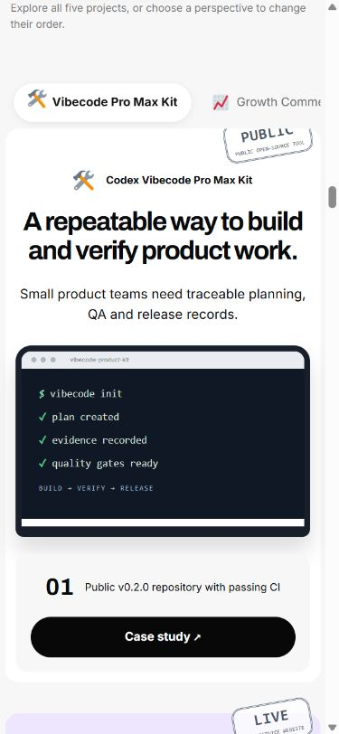

# Recruiter walkthrough acceptance — 13 November 2026

**Local candidate: pass. Production publication: unchanged.**

Preview: http://127.0.0.1:3037/Alinguyen-portfolio/

This is an operator walkthrough in desktop Chromium and a mobile-sized viewport,
not independent recruiter research, a usability benchmark or real iPhone Safari testing.
Timings include tool pauses. The walkthrough did not require selecting a role or chatting.

## Sixty-second walkthrough

| Viewport | Public evidence confirmed within | Actions | Findings |
|---|---:|---|---|
| Desktop 1280 × 900 | 37.634 seconds | Explore engineering work → Case study → View repository, with scrolling | What Ali builds; his maintainer role; offline delivery decision; public repository; unmeasured adoption/productivity limits |
| Mobile 390 × 844 | 25.846 seconds | Same three links, with scrolling | Same role, decision, source and limitation; no horizontal page overflow |

The opening explanation names applied AI prototypes, data workflows, developer tools
and commerce products. The selected Vibecode case identifies Ali as maintainer of the
public DUYTRUYENTHONG repository. Its Read view explains the offline CLI decision and
explicitly avoids adoption or productivity claims. The linked GitHub page opened and
its CLI, delivery contract, limitations, v0.2.0 release and account contributor were visible.

**Hesitation:** the repository action is below the case-study narrative, so it requires
scrolling. The project index and labeled decision/evidence/limits sections kept both
routes under sixty seconds. This remains a useful candidate for later independent
usability testing; these timings do not establish how all recruiters perform.

## Requirement audit

| Requirement | Current evidence |
|---|---|
| One-click homepage CV | Direct `download` link to `/Alinguyen-portfolio/cv-applied-ai-engineer.pdf`; observed earlier one-click download `cv-applied-ai-engineer (8).pdf`; unchanged PDF SHA-256 `01a8fbe9a35dcffcfc7cceddad99df8720a24eeb767c046c7762d5f0eeb5f391` |
| Scrolling marks a new topic | Community heading observed `home-heading-enter`, opacity .757266 while running, then completes; headings retain legibility throughout |
| Direct project jump is immediate | Enter on KKBox index link reached `#project-kkbox-baseline`; heading opacity 1 and state complete |
| Return from a case is immediate | Back to selected work reached `#work`; heading opacity 1, state complete, top 124.35px |
| Terminal explains the command result | `vibecode init` followed by plan, evidence and quality-gate output; observed staggered `home-check-enter` animations |
| Cutoff animation explains exclusion | Earlier-event dots use `home-past-event`, snapshot uses `home-snapshot`; persistent text says past events only and labels the diagram conceptual |
| Motion-off examples remain understandable | Reduced-motion terminal rows and cutoff parts all opacity 1, animation none; explanatory text remains present |
| Inspect role, decision, source and limit from a card | Both timed routes reached all four in Vibecode; case footer has contact and return links; homepage CV remains directly available |
| Responsive layout | No horizontal page overflow at 390, 768 and 1280px; mobile project screenshot below |

## Fix made during acceptance

Media previously started animating as soon as its outer frame touched the viewport.
At 1280 × 900, the terminal frame at top 832.54px had already spent its reveal before
the command output was visible. Media now waits until 30% is inside the observer's
inset viewport. In the repeated natural-scroll check it remained waiting at 832.54px,
then ran at 732.54px with the command/output stagger visible. Headings still begin
at entry. Fast scroll, fragment navigation, keyboard focus and reduced motion still
settle immediately. No homepage structure or copy was changed.

Browser observations: [runtime receipt](evidence/recruiter-motion-runtime.json).

Screenshot: 390 × 844; SHA-256
`c4bc5f1b206bc8e7dc871e6614ac33bf198333ac0506848d05e242efaac89d08`.

## Checks and boundaries

The isolated candidate excludes unrelated uncommitted finder work. Its 49 frontend
tests, TypeScript check, lint and production Pages export passed after the behavior
change. Review checked observer thresholds, image-load eligibility, jump/focus
settling, played-once state and cleanup. Geometry is read only on observer/load
events; no extra frame loop, dependency, network call or provider call was added.

The separate AI release gate remains incomplete: two real Groq source-selection
checks passed and two omitted-metric checks abstained. Its four-call budget is used.
Those results do not block the deterministic recruiter path tested here and are not
reclassified as a full AI acceptance pass. No production deployment or push occurred.
